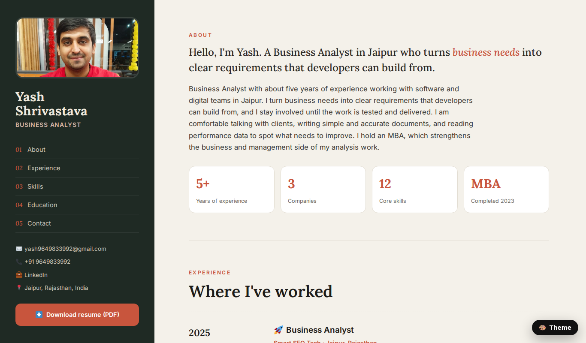
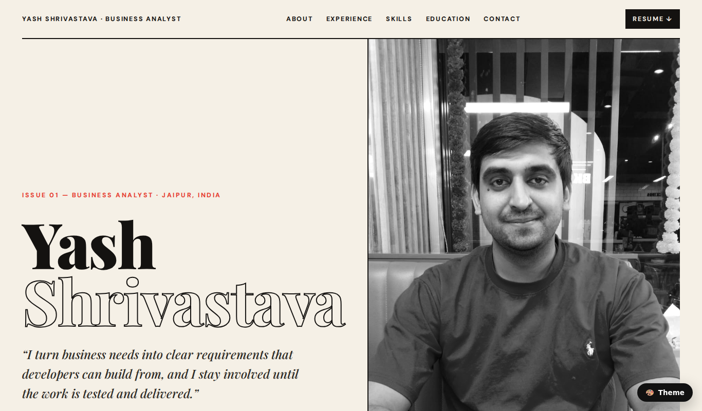
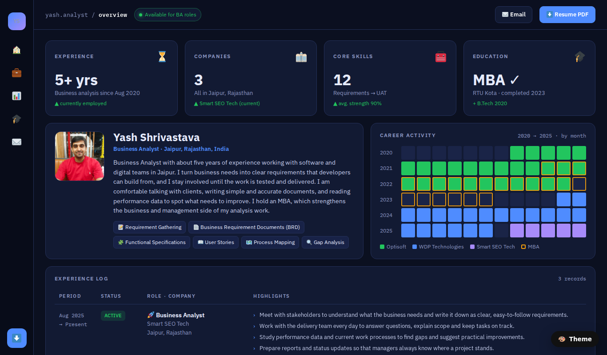

# Yash Shrivastava — Portfolio

Portfolio website of Yash Shrivastava, Business Analyst (Jaipur, Rajasthan, India).

**Live site:** https://yash9649833992-prog.github.io/yash.github.io/

[](https://yash9649833992-prog.github.io/yash.github.io/)

## Themes

The site ships with three layouts. The default is **Classic CV**; the 🎨 Theme button in the bottom-right corner of every page switches between them, and the choice is remembered in the browser.

| Theme | URL | Style |
|---|---|---|
| 🗂️ Classic CV (default) | [/](https://yash9649833992-prog.github.io/yash.github.io/) | Fixed sidebar with photo, nav and contact; cream content column with serif headings |
| 📰 Editorial | [/themes/editorial/](https://yash9649833992-prog.github.io/yash.github.io/themes/editorial/) | Magazine layout: giant serif name, full-height portrait, sideways-scrolling career cards |
| 📊 Dashboard | [/themes/dashboard/](https://yash9649833992-prog.github.io/yash.github.io/themes/dashboard/) | Analytics-app layout: KPI tiles, career heatmap, experience table, skill bars |

| Editorial | Dashboard |
|---|---|
| [](https://yash9649833992-prog.github.io/yash.github.io/themes/editorial/) | [](https://yash9649833992-prog.github.io/yash.github.io/themes/dashboard/) |

## What's on the site

- Profile, experience (Smart SEO Tech, WDP Technologies, Optisoft Business Solutions), skills, education (MBA · B.Tech, RTU Kota) and contact details
- Downloadable one-page resume PDF (`assets/files/Yash_Shrivastava_Resume.pdf`)
- Fully responsive, no build step, no frameworks — plain HTML, CSS and a little vanilla JS
- Emoji rendered with [Twemoji](https://github.com/jdecked/twemoji) so they look the same on every device

## Repository layout

```
index.html                     Classic CV theme (default page)
themes/editorial/index.html    Editorial theme
themes/dashboard/index.html    Dashboard theme
assets/img/yash.jpg            Portrait photo
assets/files/Yash_Shrivastava_Resume.pdf
assets/favicon.svg             Favicon (plus 32/180/512 px PNG versions)
docs/screenshots/              Screenshots used in this README
```

## Updating

- **Resume:** replace `assets/files/Yash_Shrivastava_Resume.pdf` with the new PDF (keep the file name) and all three themes pick it up.
- **Photo:** replace `assets/img/yash.jpg`.
- **Text:** edit the HTML files directly; each theme is a single self-contained page.

## Running locally

Any static file server works, for example:

```bash
python3 -m http.server 8080
# then open http://localhost:8080/
```

## Hosting

Served by GitHub Pages from the `main` branch (root folder). Pushing to `main` redeploys the site within a minute or two.

---

© Yash Shrivastava · yash9649833992@gmail.com · [LinkedIn](https://www.linkedin.com/in/yash-shrivastava-2aa1141a4)
